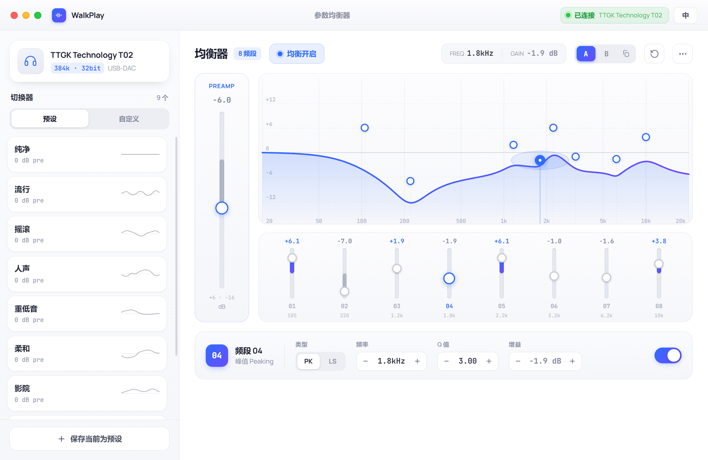
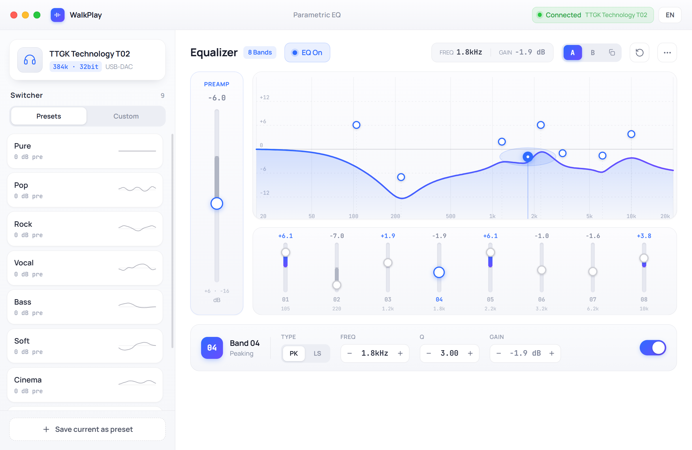

# Walkplay EQ

> 一款为 **Walkplay / TTGK Technology T02** 系列 USB DAC 耳放打造的桌面参量均衡器（PEQ）控制软件。

Walkplay EQ 让你在 Windows 桌面上直接调节硬件耳放的 8 段参量均衡——拖动滑块即时写入设备，并以实时频响曲线可视化效果。基于 [Tauri 2](https://tauri.app/) + React 构建，原生、轻量、无需常驻浏览器内核之外的额外运行时。

<p align="center">
  
</p>

<p align="center">
  <sub>实时频响曲线 · 8 段参量均衡 · 预设切换器 · 前置增益 · 内置简体中文 / English 双语界面</sub>
</p>

<details>
<summary>📷 English UI（点击展开英文界面截图）</summary>

<p align="center">
  
</p>

</details>

> [!WARNING]
> 本项目为**第三方独立开发**，与 Walkplay / TTGK Technology 官方无任何隶属或合作关系。设备通信协议通过对照官方网页应用逆向得到，**仅在 T02（VID 0x3302 / PID 0x12CB）上验证过**。使用前请阅读下方[免责声明](#-免责声明)。

---

## ✨ 功能特性

- **8 段参量均衡（PEQ）**：与设备的 8 个频段一一对应，每个频段可独立调节
  - 频率（Hz）、Q 值、增益（dB）
  - 滤波器类型（峰值 Peaking / 低架 Low-shelf / 高通 High-pass / 低通 Low-pass），与官方应用为 T02 提供的一致
  - 单段开关
- **前置增益（Preamp）**：全局预增益（-16 ~ +6 dB，整数步进），避免叠加增益后削顶失真
- **保存到设备**：应用预设或保存自定义 EQ 后，设备会把它写入自身闪存——拔下来接到手机上，EQ 依然生效；拖动滑块时只是试听，不写闪存
- **恢复出厂**：一键把设备恢复出厂设置（平直 EQ）
- **麦克风增益**：在「更多」菜单里调节设备的麦克风增益（-15 ~ +15 dB），设备会记住
- **固件版本**：连接后显示设备的固件版本
- **实时频响曲线**：对数频率轴响应图，与下发给设备的滤波器使用同一套系数计算，所见即所得
- **预设管理**
  - 内置预设：官方应用为 T02 提供的 8 个预设（纯净 / 流行 / 摇滚 / 人声 / 重低音 / 柔和 / 影院 / 游戏），以及 WH-1000XM5 的 AutoEQ Harman 调音
  - 自定义预设：保存当前调音，支持**重命名、删除、更新**，本地持久化
- **EQ 试听**：不动设备，先在电脑上试听预设的效果
- **A/B 对比**：两套 EQ 一键切换
- **托盘常驻、按需开窗**：启动后只驻留托盘，不创建窗口也不加载 WebView；单击托盘图标或再次启动程序才打开编辑窗口，关闭窗口即释放其内存
- **托盘菜单**：查看连接状态、快速切换 EQ 预设（当前预设带勾选）、开关开机自启动，文案跟随界面语言
- **开机自启动**：首次运行默认开启，可在托盘菜单或窗口「更多」菜单中关闭
- **自动恢复 EQ**：上次的 EQ 保存在本地，启动或设备重新插入后由后台直接写回设备，无需打开窗口
- **自动连接**：插入设备即自动连接，支持热插拔重连；手动断开后不会自动重连
- **中英文双语**：内置 i18n（简体中文 / English）

## 🎧 支持的设备

- Walkplay / TTGK Technology **T02** USB DAC 耳放

> 其他 Walkplay 系列设备如使用相同的 HID biquad 系数协议，理论上可兼容，但尚未验证。欢迎提交 Issue 反馈你的设备。

## 🧱 技术栈

| 层 | 技术 |
| --- | --- |
| 前端 | React 19 · TypeScript · Vite 7 · Tailwind CSS v4 · shadcn/ui（Radix UI） |
| 状态 / i18n | Zustand · i18next / react-i18next |
| 桌面框架 | Tauri 2（Rust） |
| 设备通信 | HID（`hidapi`），T02 biquad 系数协议（report `0x3302`） |

项目是一个 Cargo workspace：

- `src-tauri/` —— Tauri 应用后端（HID 通信、托盘、状态持久化）
- `crates/walkplay-dac-protocol/` —— 设备协议编解码 crate

## 🚀 开发与构建

### 环境要求

- [Node.js](https://nodejs.org/) 18+
- [Rust](https://www.rust-lang.org/tools/install) stable 工具链
- Tauri 2 的[系统依赖](https://tauri.app/start/prerequisites/)（Windows 需 WebView2 + MSVC 构建工具）

### 安装依赖

```bash
npm install
```

### 本地开发

```bash
# 启动 Tauri 桌面应用（带热重载）
npm run tauri dev

# 仅启动前端（浏览器预览，无设备通信）
npm run dev
```

### 测试

```bash
# 离线测试：与官方网页应用的参考字节逐字节比对，并检查「曲线 == 实际下发」
npm test
```

连着真机时还可以跑硬件在环测试（PowerShell）。`read` 只向设备提问；`write`、`save` 会改写设备上的 EQ，具体见 `tests/hil/t02-readback.test.ts` 开头的说明：

```powershell
$env:WALKPLAY_HIL = "read"; npx vitest run tests/hil
```

### 打包构建

```bash
npm run tauri build
```

构建产物（安装包 / 可执行文件）位于 `src-tauri/target/release/bundle/`。

## 📁 项目结构

```
.
├── src/                          # 前端（React + TS）
│   ├── features/
│   │   ├── chrome/               # 标题栏（窗口控制、连接状态、语言）
│   │   ├── switcher/             # 左侧预设切换器
│   │   ├── stage/                # 工具栏、频段检视栏
│   │   ├── instrument/           # 曲线 + 推子一体的均衡器主体
│   │   ├── curve/                # 频响计算
│   │   ├── eq/                   # 滤波器系数、T02 协议组帧
│   │   └── presets/              # 内置预设、试听
│   ├── lib/                      # 全局 store、Tauri bridge、类型、主题
│   └── i18n/                     # 中英文文案
├── src-tauri/                    # Tauri 后端（Rust）
│   └── src/{lib,hid,tray}.rs
└── crates/
    └── walkplay-dac-protocol/    # 设备识别（哪些 USB 设备是 EQ 设备）
```

## 🔌 关于设备协议

T02 使用 HID 输出报告传输 biquad（双二阶）滤波器系数：上位机将每个频段的频率、Q、增益、类型换算为定点化的滤波器系数，组成完整的 8 段程序后一次性下发并提交（commit），前置增益作为独立帧发送。相关实现见 `src/features/eq/`，协议细节以官方网页应用为参照：峰值、低架、高通、低通四种滤波器的系数与官方应用逐字节一致，参考数据在 `src/features/eq/fixtures/web-reference.json`。

> 设备只能读回第 0 段、前置增益和固件版本，读不回完整的 EQ，因此由上位机保存「当前 EQ 程序」并在每次连接时写回设备，以保证「界面 == 设备」的一致状态。该状态保存在 `%APPDATA%\com.akira.walkplay-eq\state.json`。

## ⚠️ 免责声明

- 本软件按「现状」提供，不提供任何明示或暗示的担保。
- 设备通信协议为逆向所得，可能在固件更新后失效；作者不保证其正确性或与未来固件的兼容性。
- 本软件会向设备写入均衡参数。因使用本软件造成的任何损失，作者不承担责任。
- Walkplay、TTGK Technology 及相关商标归各自所有者所有，本项目与之无关。

## 📄 License

[MIT](./LICENSE) © 2026 Akira
